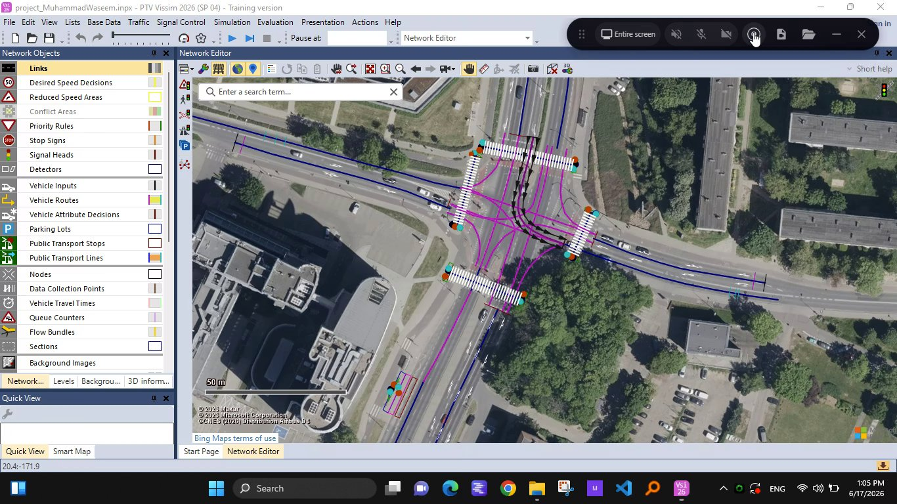

# Poznań Intersection 15 - PTV Vissim Microsimulation

A traffic microsimulation model of a signalized intersection in Poznań,
Poland, built in **PTV Vissim 2026 (SP 04)**.



## What's modelled

- Real-world intersection geometry, traced over an aerial/satellite base map
- Signal heads and signal control at each approach
- Vehicle routes and conflict areas through the junction
- Network performance measurements (delay, travel time, stops, speed) set
  up via the network's parameter aliases

## Files

```
project_MuhammadWaseem.inpx     the Vissim network/project file
screenshots/aerial-overview.png  Network Editor view of the intersection
recordings/simulation-recording.webm   screen recording of the simulation running
```

## Opening the project

You'll need **PTV Vissim** installed (this was built and tested in the
2026 SP 04 release, training version). Open `project_MuhammadWaseem.inpx`
directly from Vissim's Open dialog.

## Demo recording

`recordings/simulation-recording.webm` is a short screen recording of the
simulation running. GitHub doesn't auto-play locally stored video files
inside the README preview, so click through to the file itself (or
download it) to watch it.
